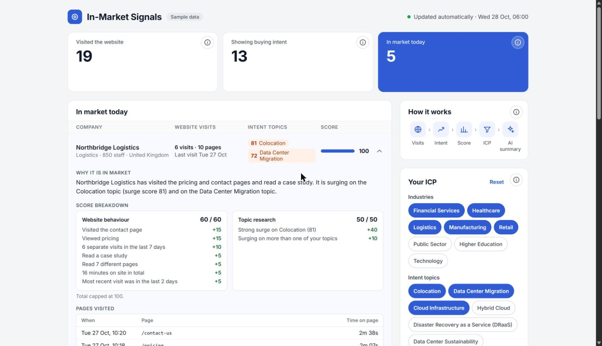
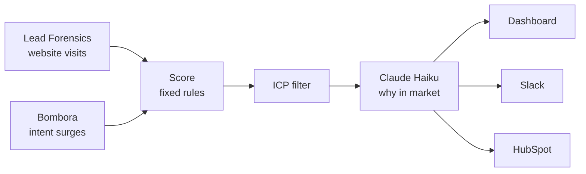

# In-Market Signals

[](https://github.com/nazia-a11y/in-market-signals/actions/workflows/daily.yml)

**[Open the live dashboard →](https://nazmh-in-market-signals-dashboard.static.hf.space)**

[](https://nazmh-in-market-signals-dashboard.static.hf.space)

## The problem

B2B marketing teams usually look at two kinds of buying signal in two different places. Website visitor tools such as Lead Forensics show which companies came to our site. Intent data such as Bombora shows which companies are researching our topics across the web. Neither is reliable on its own: a single visit can be a student or a competitor, and an intent surge says nothing about whether the company knows we exist.

## What this does

Every weekday at 6am, without anyone pressing a button, this system:

1. collects the last 7 days of website visits, page by page;
2. adds Bombora intent surges for those companies, matched on Bombora's own Topic IDs;
3. scores each company out of 100 with fixed, visible rules;
4. removes companies outside the ideal customer profile and existing customers;
5. asks Claude to write a short, factual summary of why each account appears to be in market;
6. publishes the list to the dashboard, and to Slack and HubSpot when they are connected.

The output is a list, not a campaign. The same list can feed sales outreach, paid media audiences, email nurture or website personalisation.



## How the score works

**Rules score, AI explains.** The score comes from transparent rules, so anyone can see exactly why an account is on the list and the result is the same every time. The AI only turns those facts into two plain sentences, and it is told to use nothing but the facts it is given.

| Website behaviour (Lead Forensics), up to 60 | Points |
| --- | --- |
| Visited the contact page | 15 |
| Viewed pricing | 15 |
| 3 or more separate visits in 7 days | 10 |
| Read a case study | 5 |
| Read 5 or more different pages | 5 |
| 10 or more minutes on the site in total | 5 |
| Most recent visit in the last 2 days | 5 |

Page views under 30 seconds are treated as bounces and ignored.

| Topic research (Bombora), up to 50 | Points |
| --- | --- |
| Surge of 70 or more on one of our topics | 40 |
| Surge of 60 to 69 on one of our topics | 20 |
| Surging (60 or more) on more than one of our topics | 10 |

Neither source can reach the threshold of 70 on its own, so an account only counts as in market when our own data and third-party data agree. The total is capped at 100.

## Design decisions

**Existing customers are left out automatically.** When HubSpot is connected, each run checks it for companies that are customers or have an open deal. A customer browsing the pricing page looks exactly like a hot prospect, and should never be targeted as one.

**Topics follow Bombora's taxonomy.** The ICP lists intent topics by their Bombora Topic ID (for example Colocation, 1500174). Surges are matched on that ID rather than the name, so a renamed topic cannot silently break the scoring.

**Every likely account is summarised.** Claude writes a summary for every company that would reach the threshold on any of the topics we track, not only those in today's ICP. When someone widens the ICP on the dashboard, the accounts it adds already have their explanation.

**Low cost by design.** Claude Haiku is more than capable of writing two sentences from a set of facts. A daily run makes around 16 short calls and costs a few pence.

**Safe to publish.** The API keys live in GitHub's encrypted secrets and never reach the dashboard. Only firmographic and behavioural facts about companies are sent to the AI, never personal data.

## About the demo

The companies and website visits are invented, so the demo can be public. The intent topics are real topics from Bombora's taxonomy. The data is fixed rather than random, so the dashboard tells the same story every day while the engine still runs on schedule.

On the dashboard, the ICP panel can be changed freely. Every option changes the list, and accounts it adds are tagged "New with this ICP".

## Using it with real data

| You need | For |
| --- | --- |
| Lead Forensics, with API access | Website visits |
| Bombora Company Surge, with API or data export access | Intent surges |
| A Claude API key | The summaries |
| GitHub and Hugging Face (free tiers) | Running the engine, storing results, hosting the dashboard |
| HubSpot and Slack (optional) | Excluding customers and receiving the daily list |

1. Copy this repository into a private repository.
2. Add the API keys as GitHub Actions secrets (see `.env.example` for the names).
3. Edit `icp.json`: industries, company size, countries, Bombora topic IDs and the HubSpot stages to leave out.
4. Complete the two connectors in `app/sources.py` for your Lead Forensics and Bombora accounts, then set `DEMO_MODE` to false in `.github/workflows/daily.yml`.
5. Keep the results dataset private.

## What is in this repository

| Path | Purpose |
| --- | --- |
| `app/sources.py` | Collects visits and intent data (sample data, or your connectors) |
| `app/scoring.py` | Scores the buying signals |
| `app/icp.py` | Loads the ICP and checks each account against it |
| `app/explain.py` | Asks Claude for a short summary of the signals |
| `app/deliver.py` | Publishes results to the dataset, Slack and HubSpot |
| `app/pipeline.py` | Runs everything in order |
| `icp.json` | The ideal customer profile and intent topics |
| `dashboard/index.html` | The dashboard, a single static page |
| `.github/workflows/daily.yml` | The weekday schedule |

## Run it yourself

```bash
cp .env.example .env    # add your keys
docker build -t in-market-signals .
docker run --rm --env-file .env in-market-signals
```

Built with Python, Docker, GitHub Actions, the Claude API and Hugging Face.
