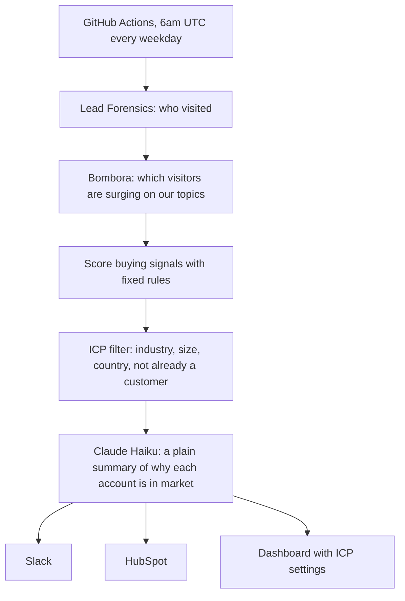

# In-Market Signals Engine

**Live demo:** https://huggingface.co/spaces/nazmh/in-market-signals-dashboard

Every weekday morning, this system identifies which accounts are in market right now, and why. It combines two signals that are usually looked at separately: which companies visited our website (first-party data from Lead Forensics) and which companies are researching our topics elsewhere (third-party intent data from Bombora). It then keeps only the accounts that fit our ideal customer profile and are not already customers.

There are no manual steps. Nobody exports a spreadsheet or uploads a file.

The output is a list, not a campaign. The same daily list can feed sales outreach, paid media audiences, email nurture or website personalisation, depending on what each team needs.

> The public demo runs on invented companies shaped like real Lead Forensics and Bombora data. One setting switches it to the real APIs.

## How it works



## Design decisions

**Rules score, AI explains.** The score comes from transparent rules, so anyone can see exactly why an account is on the list and the result is the same every time. The AI only turns those facts into a short, neutral summary. It is told to use nothing but the facts it is given.

| Signal | Source | Points |
| --- | --- | --- |
| Viewed the pricing page | Lead Forensics | 30 |
| Read a case study | Lead Forensics | 10 |
| 3 or more visits | Lead Forensics | 20 |
| Surge of 70+ on one of our topics | Bombora | 40 |
| Surge of 60 to 69 on one of our topics | Bombora | 20 |
| Surging on 2 or more of our topics | Bombora | 10 |

An account scoring 70 or more that also fits the ICP is **actionable**.

**The ICP belongs to marketing, not to the code.** The dashboard has a settings page where the person who owns the ICP can change industries, company size, countries and exclusions. A preview shows how many accounts would change before anything is saved. Every change is kept with a note, so there is a full history.

**Existing customers are excluded automatically.** Each run checks HubSpot for companies that are customers or have an open deal. A customer browsing the pricing page looks exactly like a hot prospect, and should never be targeted as one.

**Topics follow Bombora's taxonomy.** The ICP lists the intent topics we sell into by their Bombora Topic ID (for example Colocation, 1500174), and surges are matched on that ID rather than the name, so a renamed topic cannot silently break the scoring.

**Low cost by design.** Only actionable accounts are sent to the AI, and it uses Claude Haiku, which is more than capable of writing two sentences from a set of facts. A daily run costs a few pence.

**Privacy.** Only firmographic and behavioural facts about companies are sent to the AI, never personal data. Real data belongs in a private repository and a private dataset.

## What is in this repository

| Path | Purpose |
| --- | --- |
| `app/sources.py` | Collects visits and intent data (demo data or real APIs) |
| `app/scoring.py` | Scores buying signals |
| `app/icp.py` | Loads the ICP and checks each account against it |
| `app/explain.py` | Asks Claude for a short summary of the signals |
| `app/deliver.py` | Sends results to Slack, HubSpot and the dashboard's dataset |
| `app/pipeline.py` | Runs everything in order |
| `icp.json` | The starting ICP, used until one is saved from the dashboard |
| `.github/workflows/daily.yml` | The weekday schedule |

## Run it yourself

```bash
cp .env.example .env    # add your keys
docker build -t in-market-signals .
docker run --rm --env-file .env in-market-signals
```

Built with Python, Docker, GitHub Actions, the Claude API, Hugging Face and Gradio.
